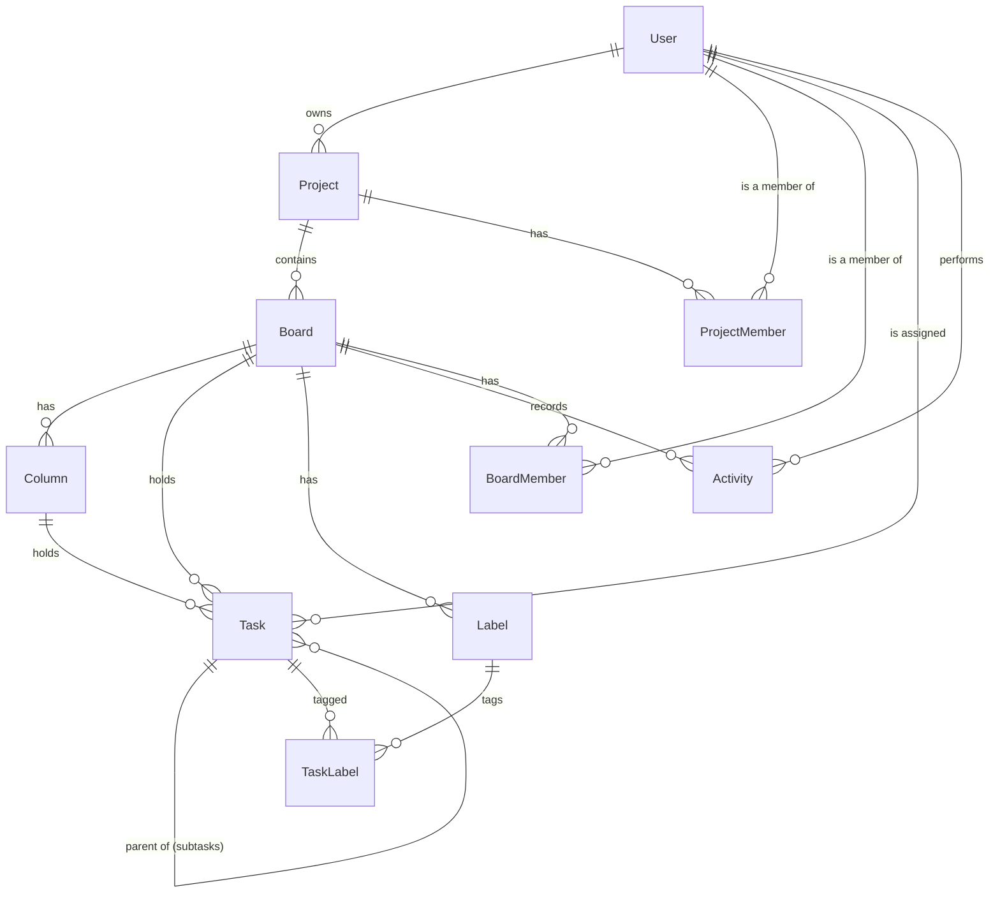

# Kanban Board

A Kanban board web app: **projects, boards, custom columns, tasks, priorities, due dates, assignments, drag-and-drop and activity history.**

## This project was built using the [OpenCode](https://opencode.ai) harness with **MiniMax - M3** as the model.

## Built With

| Layer           | Choice                                                                |
| --------------- | --------------------------------------------------------------------- |
| Runtime         | Node 26.13.1 (LTS)                                                    |
| Package manager | pnpm 12.23.0 + Turborepo 2.11.13                                      |
| Language        | JavaScript, ESM only — no TypeScript                                  |
| Framework       | Next.js 16.4.6 (App Router, Server Actions, Turbopack) + React 19.3.1 |
| Database        | PostgreSQL 19 (Docker)                                                |
| ORM             | Prisma 7.10.1 with the `@prisma/adapter-pg` driver adapter            |
| Styling         | Tailwind CSS 4.3.5 (CSS-first)                                        |
| Drag and drop   | dnd-kit (`@dnd-kit/core`, `@dnd-kit/sortable`)                        |
| Validation      | Zod 4.6.7                                                             |
| Lint and format | Biome 2.6.8                                                           |
| Tests           | `node --test` (built in)                                              |
| AI              | AI SDK 7, behind a provider interface, disabled by default            |

## Getting started

```bash
pnpm install                 # install dependencies
pnpm docker:up               # start PostgreSQL 19 on port 5434
cp .env.example .env         # create your local environment file
pnpm db:migrate              # create the database schema
pnpm db:seed                 # load the demo data
pnpm dev                     # http://localhost:3000
```

Then open <http://localhost:3000> and
<http://localhost:3000/api/health>.

Requires Node 26.13.1 — `nvm install 26.13.1 && nvm use 26.13.1` if you do not
have it yet.

## Project layout

```
kanban-board/
├── apps/
│   └── web/              Next.js app - routes, server actions, API routes
├── packages/
│   ├── ai/               AI provider contract and the pluggable providers
│   ├── config/           Environment validation, permissions, constants, logger
│   ├── db/               Prisma schema, migrations, seed, query helpers
│   └── ui/               Shared UI primitives
├── scripts/              Test runner
├── docker-compose.yml    Local PostgreSQL
└── turbo.json            Task graph
```

## Data model



Three decisions in that schema are worth reading before the code:

- **A task carries both `boardId` and `columnId`.** The column is the real
  foreign key — a task lives in exactly one column — but the board is
  denormalised onto the row so loading a whole board is one indexed query
  instead of a join. Moving a card between columns is a single `UPDATE` of two
  columns, never a delete and recreate.
- **A column cannot be deleted while it still holds tasks.** The relation is
  `ON DELETE NO ACTION`, which PostgreSQL checks at the end of the statement.
  Deleting a column with tasks therefore fails, while deleting a whole board
  still cascades cleanly — `ON DELETE RESTRICT` would have broken that.
- **Subtasks are tasks.** A subtask is a task with a `parentId`, so it
  inherits every field, filter and drag behaviour instead of needing a
  parallel implementation.

Task ordering is a fractional `position` rather than an integer index: a drop
between two cards sets the position to the midpoint of theirs, so a drag is a
single row update. The column is renormalised only when the gap between two
neighbours collapses below `1e-6`.

## Permissions

Roles are `OWNER`, `EDITOR` and `VIEWER`. The effective role on a board is
resolved in this order:

1. a platform administrator is an owner everywhere
2. a `BoardMember.role`, when one is set — it wins, and it may _lower_ a role
3. otherwise the `ProjectMember.role` is inherited from the project
4. otherwise the user has no access

The capability matrix is pure data in `@kanban/config`; the database-backed
resolver lives in `@kanban/db`. The seeded demo data includes both directions
of override, so the precedence is visible in the app rather than only in tests.

## Scripts

| Command                  | What it does                                 |
| ------------------------ | -------------------------------------------- |
| `pnpm dev`               | Start every package in dev mode              |
| `pnpm build`             | Production build                             |
| `pnpm lint`              | Biome check across the workspace             |
| `pnpm lint:fix`          | Biome check with safe fixes applied          |
| `pnpm test`              | Run every package's test suite               |
| `pnpm db:generate`       | Regenerate the Prisma client                 |
| `pnpm db:migrate`        | Create and apply a migration (interactive)   |
| `pnpm db:migrate:deploy` | Apply committed migrations (non-interactive) |
| `pnpm db:seed`           | Load the demo data (idempotent)              |
| `pnpm db:studio`         | Open Prisma Studio                           |
| `pnpm docker:up`         | Start the local database                     |
| `pnpm docker:down`       | Stop it (the data volume survives)           |

## Planned features

These are the target feature set. The milestone table in [PLAN.md](./PLAN.md)
says which one delivers each of them.

- **Projects and boards** — a project holds boards, a board holds custom columns.
  _Schema and seed data are in place; the screens land in M2._
- **Tasks** — title, description, priority, due date, assignee, labels, subtasks.
  _Schema and seed data are in place; the screens land in M3._
- **Drag and drop** — move cards within a column and across columns, with
  keyboard support, not just a mouse.
- **Filtering** — by assignee, priority, due date, label and free text, with
  shareable filter URLs.
- **Permissions** — project and board membership with OWNER / EDITOR / VIEWER
  roles, enforced on the server for every mutation.
- **Activity history** — every change recorded with who did it and when.
  _The log and its schema are in place; the timeline lands in M6._
- **Live updates** — Server-Sent Events over PostgreSQL notifications.
- **AI** — suggest subtasks, categorise tasks, draft descriptions. The interface
  and the UI ship with the project; switching on a model is configuration only.

## Deliberate limitations

This is a portfolio project, not a deployed service, and two things are
deliberately scoped down:

- **No authentication.** Identity comes from a dev cookie so you can exercise
  the permission matrix by hand. The permission _enforcement_ is real and
  server-side — only the identity is simulated.
- **No deployment.** There is no Dockerfile, no hosting config and no
  production environment. The app runs locally against the Docker database.

Both are stated in the README rather than hidden, because a reviewer reading
the code will find them either way.

## Notes

- **One `.env`, at the repository root.** The Next.js app loads it explicitly in
  `next.config.js`, because Next only reads `.env` files from its own project
  directory and this is a monorepo.
- **PostgreSQL 19 images store their data in a version-specific directory.**
  The Docker volume is mounted at `/var/lib/postgresql`, not at
  `/var/lib/postgresql/data`. Mounting the old path makes the image refuse to
  start.
- **The Prisma CLI is pinned to 7.10.1** even though npm's `latest` tag points
  at `8.0.0-rc.35`. Prisma 8 has no stable release yet, and the CLI, client and
  driver adapter must match.

## Licence

MIT
